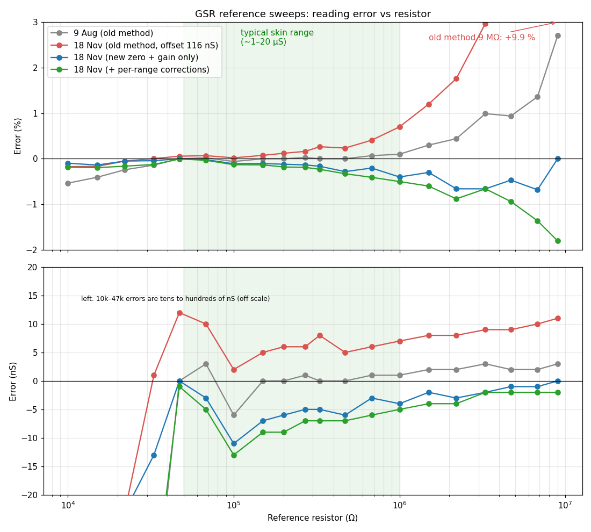
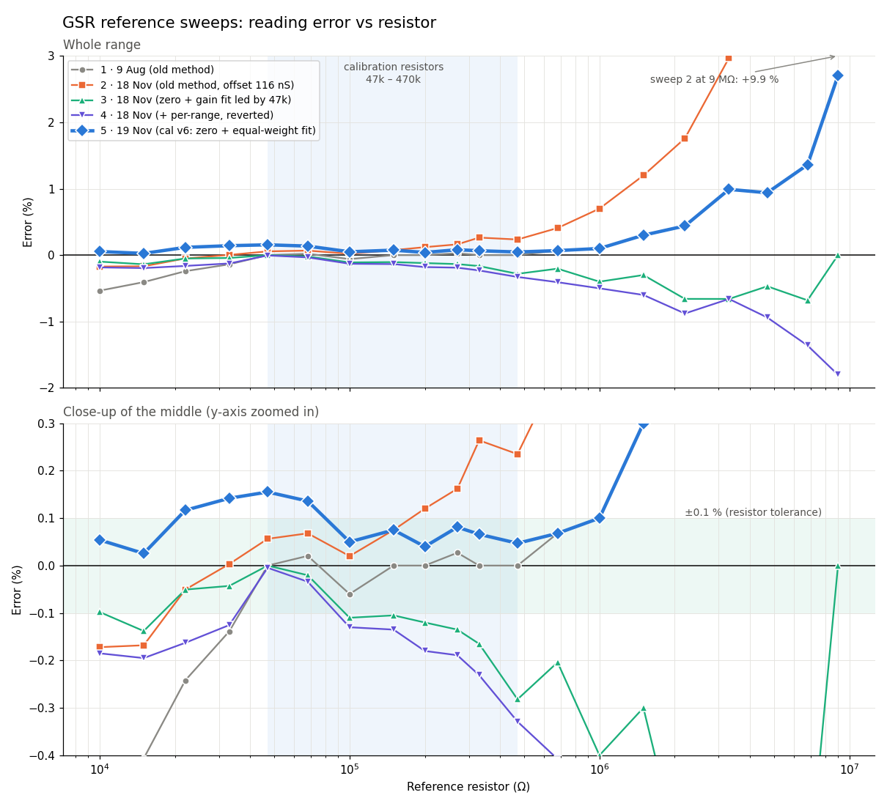

# GSR resistor sweep: what we found (18 November 2026)

## The short version

- The new sweep is **not** worse because of a firmware bug. We checked the
  maths on the device by hand, and it is doing exactly what it should.
- The bias correction was **never going to help the high-resistance end**.
  It fixes errors that grow with the reading. The high-end error is a
  fixed few nS that doesn't grow with the reading.
- The high end (1–9 MΩ) depends almost entirely on one number from the
  calibration: the **offset**. On the prototype board that offset is very
  large (116 nS), and small changes in a calibration run move it by
  several nS. At 9 MΩ (111 nS) a few nS is several percent.
- August reading +2.7 % at 9 MΩ and today +9.9 % is most likely
  **two different calibration runs landing in different places**, not one
  firmware being better than the other.
- **Confirmed later the same day:** with nothing connected, the board reads
  −313 counts, a true zero error of about 104 nS. The saved calibration
  assumed 116 nS. That 12 nS difference accounts for the high end almost
  exactly (see "Still to explore", item 2).
- **Fixed the same evening:** the wizard now measures the zero directly.
  A new sweep (`reference_test_results3.csv`) has every point from 10 kΩ to
  9 MΩ within ±0.7 %. See "Result with the new calibration" below.
- **Tested and dropped the same night:** the idea that the converter's
  ranges (PGA) caused the middle to read 0.1–0.3 % low. Measured on the
  device, PGA 4 and PGA 5 agree to 0.001 %, so they can't be the cause. A
  per-range correction was built, tried
  (`reference_test_results4.csv`) and removed. See "Tested: the ranges
  are not the cause" below. The middle error is most likely the resistor
  board's own 47k setting.

- **19 November: equal-weight fit.** The wizard's gain fit now gives
  47k, 100k and 470k an equal say. Sweep 5
  (`reference_test_results5.csv`): every point from 10 kΩ to 1 MΩ is
  within ±0.16 %, and the middle (100k–470k) is +0.04 to +0.08 %. See
  "Sweep 5: equal-weight fit (19 November)" below.

## Why the bias correction doesn't help the high end

There are two kinds of error:

- **Scale errors** make every reading a fixed *percentage* too high or too
  low. A wrong 0.5 V bias is one of these: if the bias is 0.3 % low, every
  reading is 0.3 % high.
- **Offset errors** add or take away a fixed *number of nS*. 6 nS is
  nothing at 10 kΩ (100 000 nS) but over 5 % at 9 MΩ (111 nS).

The bias correction removes a scale error. The high-end problem is an
offset error. So the bias correction can help the low and middle range
(and it may have: 10 kΩ went from −0.54 % to −0.17 %), but it can't touch
the top end. That expectation was wrong from the start.

## Why the offset is so shaky on this board

The prototype reads about **116 nS too low before calibration**. It looks
like a fixed error of about 2.6 mV at the converter's input. The likely
sources are the MCP6002 op-amp (it can be up to 4.5 mV off) or the
protoboard. The calibration adds the 116 nS back.

But the calibration never measures that 116 nS directly. It measures
47 kΩ, 100 kΩ and 470 kΩ (about 2 000 to 21 000 nS), draws a straight line
through them, and **extends the line down to zero**. Extending a line that
far magnifies small errors:

| If this calibration point reads 0.1 % high | the 9 MΩ reading moves by |
|---|---|
| 47 kΩ | about +6 nS (+5 %) |
| 100 kΩ | about −4 nS (−4 %) |
| 470 kΩ | about −2 nS (−2 %) |

0.1 % is the tolerance of the calibration resistors. The same resistors
are used every time, so their tolerance gives a fixed error. It explains
why the high end can be a few nS out, but not why two runs differ.

The runs did differ. Two wizard runs today gave:

| Run | Gain | Offset | 470 kΩ would read |
|---|---|---|---|
| Photo of the "Success" screen | 1.002 | 109 nS | about 2 128 (correct) |
| The one saved and used for the sweep | 1.001 | 116 nS | about 2 133 |

The saved run is the one the sweep used, which is why everything above
about 68 kΩ reads 5 to 11 nS high.

## What we ruled out (tested on the device)

- **The radio scan:** GSR Only mode, which has no radio, read the same.
- **The menu beep upsetting the bias reading:** turning sound off changed
  nothing.
- **When the bias is read:** starting a recording re-reads it, and the
  reading didn't move.
- **The firmware applying the calibration wrongly:** by hand,
  gain × (reading from Mean and Vb) + offset matches the Filt line.

## Mistakes in the investigation

- An early comparison ("everything is +6 nS since August") compared two
  sweeps with different calibrations. It looked convincing but wasn't a
  fair test.
- The beep theory was announced too confidently, before there was any
  evidence for it.
- The per-range correction was built into the wizard before the range idea
  had been checked on the device. A one-off check would have answered the
  question with less code. It did no lasting harm (it was never committed),
  but it is the same mistake as the beep theory: the pattern in the sweep
  looked convincing and wasn't proof.
- "Calibration should be accurate to 1 nS everywhere" came from an
  idealised model that ignored resistor tolerance and run-to-run changes.
  It was too optimistic.

## Also found and changed

- The "cuffs disconnected" check first used gain × uncalibrated reading,
  leaving out the offset, because a 116 nS offset would have made an open
  circuit look connected. With the new calibration there is no offset any
  more (the zero is removed before the conversion), so the check now uses
  the fully calibrated value, and high resistances on this prototype no
  longer read as disconnected.
- `reference_test_results2.csv`, `reference_test_results3.csv` and
  `reference_test_results4.csv` have their minus signs back and a date
  line. The spreadsheet that makes them
  drops the sign of the error, so most of the readings were actually low.

## Result with the new calibration

The wizard now measures the board's zero with nothing connected, removes
it before converting to nS, and fits a gain only (no offset). Sweep in
`reference_test_results3.csv`, signed errors:

| Range | August | 18 Nov (old method) | New |
|---|---|---|---|
| 10k–33k | −0.14 to −0.53 % | −0.17 to 0 % | −0.04 to −0.14 % |
| 47k–470k | about 0 % | +0.02 to +0.26 % | 0 to −0.28 % |
| 1–9 MΩ, average error | 0.98 % | 3.94 % | 0.45 % |
| 1–9 MΩ, worst point | +2.70 % | +9.91 % | −0.68 % |

**What improved**

- **The high end is fixed.** 9 MΩ went from +11 nS to 0 nS, and nothing
  from 1 MΩ up is more than 4 nS out. The 104 nS zero error is now being
  removed correctly.
- **The low end is the best of the three sweeps.** 10 kΩ reads −0.10 %
  (−0.53 % in August).

**What got slightly worse**

- **The middle (100k–470k) reads 0.1–0.3 % low.** In August it read about
  0 % there. The gain-only fit is mostly decided by the 47k point (the
  largest number), so whatever is different about 100k and up shows.
- **It is a percentage error, not a leftover zero.** In nS it shrinks
  towards high resistance: about −11 nS at 100k, −6 nS at 470k, −4 nS at
  1 MΩ and 0 at 9 MΩ. A wrong zero would be the same number of nS
  everywhere.

### Why the middle reads low: first idea, since ruled out

This was the reasoning at the time. The device test in the next section
showed PGA 4 and 5 read the same, so the idea below is wrong. It is kept
so the same idea isn't tried again.

**First idea: the converter's ranges (PGA) don't read quite the
same.** The ADS1115 switches range depending on how big the signal is.
Working out which range each resistor lands on (connected after a gap with
nothing attached, as when swapping clip leads):

| Range | Resistors | New sweep error |
|---|---|---|
| PGA 2 | 10k, 15k | −0.10, −0.14 % |
| PGA 3 | 22k, 33k | −0.05, −0.04 % |
| PGA 4 | 47k, 68k | 0.00, −0.02 % |
| PGA 5 | 100k and up | −0.10 to −0.18 % (100k–330k) |

Each pair agrees with itself, and the jump sits exactly between 68k and
100k, where the range changes from 4 to 5. The gain is set mostly by 47k
(range 4), so range 5, where most real skin readings land, ends up about
0.1 % low. The datasheet allows ranges to differ by roughly this much.

**The old offset term was hiding this, not curing it.** Two numbers (gain
and offset) can only pass exactly through three points if the three errors
happen to lie on a straight line. A range step between 47k and 100k nearly
does over 2 000–21 000 nS, so the old fit tilted the line and added a few
nS of offset to cover it. A simulated −0.1 % step on range 5, put through
the old fit, gives 100k at −0.06 % (August's exact figure), the middle
near 0 %, and about +6 nS too much at the high end. August's high end did
read +2 to +3 nS high. That creep was the price.

**Putting the offset back would undo the high-end fix.** Applying the old
gain + offset fit on top of the new readings (using the 47k, 100k and
470k points) brings 150k–330k to about 0 to +0.1 %, but 470k goes to
+0.14 % and the fit adds +9.5 nS, so 9 MΩ would read about +8 %.

**Above 470k the rest is small.** Taking out a −0.12 % range-5 error leaves
1–9 MΩ about −1.4 nS on average: a few counts of zero drift plus the
±0.5 nS display rounding.

**Caveats.** A single point within 0.1 % can't be told apart from its own
0.1 % resistor (100k's −11 nS is right at its tolerance). The case rests on
five resistors in a row (150k–470k) reading low together and the jump
matching the range change. It also assumes there was a gap between
resistors; swapped without a gap, the ranges move and the grouping fits
much worse. Not yet checked on the device.

### Tested: the ranges are not the cause

To test the idea, the wizard's 100k step was changed to read the
resistor on PGA 5, 4, 3, 2 and 5 again, holding each range for 3 s, and
to save one correction per range. Using the same resistor on every range
means its tolerance doesn't matter. The success screen showed the largest
difference as 0.1 %. The saved corrections (`biomap.cal` and the header
of `biomap_036.csv`) were:

| Range | Correction | Meaning |
|---|---|---|
| PGA 2 | 0.99948 | read 0.05 % high against PGA 5 |
| PGA 3 | 0.99905 | read 0.10 % high against PGA 5 |
| PGA 4 | 1.00001 | same as PGA 5 |
| PGA 5 | 1 | reference |

Same calibration run: gain 0.9992, zero −326.7 counts, noise
0.11 / 0.18 / 0.54 nS.

The sweep with these corrections (`reference_test_results4.csv`, with the
range of each reading noted):

| Resistors | Range | Before (results3) | With corrections (results4) |
|---|---|---|---|
| 10k, 15k | PGA 2 | −0.10, −0.14 % | −0.18, −0.19 % |
| 22k | PGA 2 (PGA 3 before) | −0.05 % | −0.16 % |
| 33k | PGA 3 | −0.04 % | −0.13 % |
| 47k, 68k | PGA 4 | 0.00, −0.02 % | 0.00, −0.03 % |
| 100k–470k | PGA 5 | −0.11 to −0.28 % | −0.13 to −0.33 % |
| 1–9 MΩ | PGA 5 | 0 to −4 nS | −2 to −5 nS |

**What this shows**

- **PGA 4 and PGA 5 agree**, so the jump between 68k and 100k is not a
  range effect. The middle didn't move, as expected once that's known.
- **PGA 2 and 3 do differ from PGA 5 when read at the 100k level**, and
  the firmware applied that correctly: 33k moved by −0.09 %, matching its
  −0.095 % correction. But the low end then agreed *less* with the
  resistor board, not more. Either the difference measured at 100k's
  small signal (10–20 % of those ranges) doesn't hold at the larger
  10k–33k signals, or the board's own 0.1 % tolerance hides it. These
  references can't tell which.
- **The high end shifted by about 2 nS.** That comes from the zero:
  −327 counts this run against about −313 earlier. 14 counts is about 4 nS at
  the bottom of the range, so two wizard runs' zeros differ by a few nS.

**Decision:** the per-range correction was removed (firmware back to the
committed version: calibration file v6, zero + gain only). The device
needs the wizard run again, because a v7 file is ignored.

**Most likely cause of the middle now: the reference values themselves.**
The wizard's gain is set mostly by the 47k, and the sweep uses the same
resistor board. If the board's 47k setting is about 0.1 % off (its
tolerance allows this), the calibration builds that in, 47k reads exactly
0 % in every sweep, and the rest read about 0.1 % low. That is the
pattern in both the results3 and results4 sweeps. No firmware change can
fix it; it can only be checked against a more accurate reference.

**A limit on the high-end numbers:** the diagnostic screen shows whole nS,
which is itself ±0.5 nS. At 9 MΩ (111 nS) that is ±0.45 %, so the 1–9 MΩ
percentages are at the edge of what the screen can show, and "0.00 % at
9 MΩ" is partly luck.

**Not changed:** the README's "±0.1 % (calibrated)" accuracy claim. The
middle range is now −0.1 to −0.3 %, so it is a little optimistic for this
board.

## Sweep 5: equal-weight fit (19 November)

**Headline: from 10 kΩ to 1 MΩ (the whole skin range) every reading is
within ±0.16 % (worst 0.16 %, average 0.08 %). Above 1 MΩ readings are
within 3 nS, which is +2.7 % at 9 MΩ.**

The wizard's gain-only fit used to be ordinary least squares, which gave
the 47k point (about 21,000 nS) about 81 % of the say and 470k under
1 %. It now minimises the *percentage* error, so all three calibration
resistors count equally. Firmware: calibration file v6 (zero + gain),
commit `594dbf7`. Sweep in `reference_test_results5.csv`.

| Range | August | Sweep 3 (fit led by 47k) | Sweep 5 (equal weight) |
|---|---|---|---|
| 10k–33k | −0.14 to −0.54 % | −0.04 to −0.14 % | +0.03 to +0.14 % |
| 47k–68k | 0 to +0.02 % | 0 to −0.02 % | +0.14 to +0.16 % |
| 100k–470k | 0 to −0.06 % | −0.10 to −0.28 % | +0.04 to +0.08 % |
| Worst point, 10k–1M | 0.54 % | 0.40 % | **0.16 %** |
| Average error, 10k–1M | 0.12 % | 0.13 % | **0.08 %** |
| 9 MΩ | +2.70 % (+3 nS) | 0.00 % | +2.70 % (+3 nS) |

**What improved:** the middle no longer slides downwards with
resistance. 100k–470k now sit inside the ±0.1 % band of the resistors'
own tolerance.

**What it cost:** 47k and 68k now read about +0.15 % instead of 0 %. A
single gain can't put 47k and 470k both at exactly zero when they
disagree by about 0.1 %, so it splits the difference.

**The 68k→100k step is still there** (about 0.09 %, the same size as in
sweep 3). The fit moved the line but didn't remove the step. The step is
also in the August data (68k +0.02 %, 100k −0.06 %), so it comes from the
hardware or the resistor board, not the firmware.

**The high end moved up by about 3 nS** compared with sweep 3 (9 MΩ: 114
against 111 nS). The gain change only accounts for about 0.2 nS of that,
so the rest most likely comes from this wizard run's zero reading. That
fits "Repeatability" below: zeros from different runs have differed by a
few nS. The 680k–9M readings happen to match August's exactly.

### Why August's middle looked better

August's calibration fitted two settings: a gain and an offset. The gain
mostly sets the low-resistance end, so it put 47k at exactly 0 %; the
offset mostly sets the high end, so it put 470k at exactly 0 %. With both
ends pinned, the points between came out near zero too. The price was a
tilted line: 10k–15k read 0.4–0.5 % low.

The new method measures the zero directly and fits one setting, so it
can't pin both ends. Putting an offset back on top of the measured zero
was checked on the sweep 3 numbers: it would push 9 MΩ about 8 % high. So
August's middle was bought at the low end's expense. Sweep 5 is the more
even compromise, and its remaining 0.1–0.16 % is about the tolerance of
the resistors it is measured against.

## Still to explore

1. **Check the resistor board's 47k, 100k and 470k settings** with a
   meter better than 0.1 %, or swap in a separate 0.01 % 47k for the
   wizard. If the board's 47k is about 0.1 % low, that explains the
   middle. The PGA idea is done: see "Tested: the ranges are not the
   cause".
2. **Weighting the fit (built).** Equal-weight fitting is now in the
   firmware; see "Sweep 5: equal-weight fit (19 November)". It moves the
   error around rather than removing it: the middle is better and 47k/68k
   read about +0.15 %.
3. **Repeatability.** Run the wizard two or three times and note Gain and
   Zero each time. The zero should agree within a few counts (1 count is
   about 0.3 nS). If it does, the 18 Nov run-to-run problem has gone with
   the old method. So far: −313 counts on the diagnostic screen earlier
   and −327 from the results4 wizard run, 14 counts (about 4 nS at 9 MΩ)
   apart. Not yet two wizard runs back to back.
4. **Did the bias correction help the low end?** One sweep each still isn't
   enough. What it really protects against is drift (battery level,
   temperature, speaker load), so the fair test is the same resistor read
   over time or at different battery levels.
5. **The new PCB.** The OPA2333 should make the zero almost nothing, and
   the 0.5 V guard blocks board leakage. Repeat the sweep on it; the zero
   step should then read close to 0.

## Earlier investigation notes

- **Model check (done):** with nothing connected, `Mean:` read −313
  counts, a zero error of about 104 nS against the 116 nS the old
  calibration assumed. Putting −313 counts into the model reproduced the
  18 Nov high end to within 1–4 nS (9 MΩ: model 123, measured 122). Both
  of that day's wizard runs overshot the true offset (109 and 116 against
  ~104).
- **Measuring the zero directly (built):** the wizard starts with a
  "disconnect everything" step, removes the zero in counts before the
  conversion, and fits a gain only. The saved calibration and the CSV
  header carry `zero_counts` instead of `offset` (calibration file v6). In
  simulation, the prototype with a 2 mV offset and a 47k resistor 0.1 %
  off reads 9 MΩ within 0.15 %, against about 5 % for the old method.
  Confirmed on the device by the sweep above.
